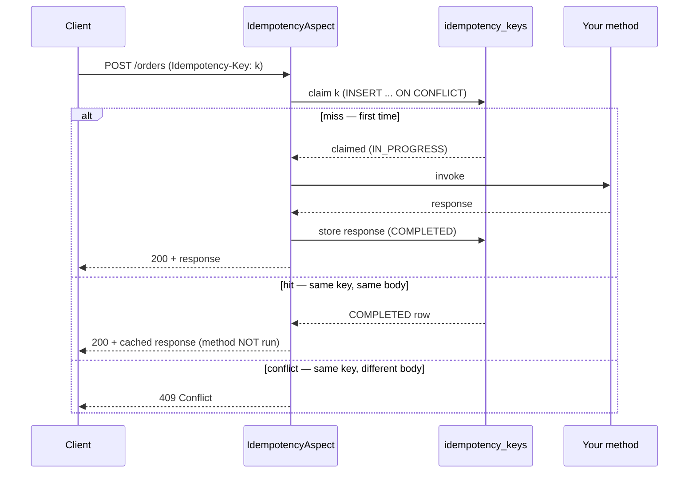
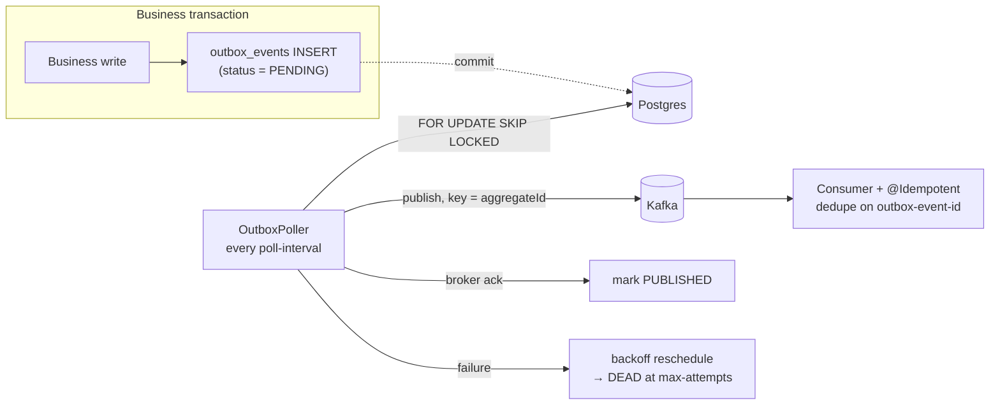

# Idempotency + Transactional Outbox — Spring Boot Starter

A drop-in Spring Boot starter for two near-universal backend problems:

1. **Request idempotency** — safely absorb client retries with an `@Idempotent`
   annotation backed by a Postgres dedupe table (client-supplied `Idempotency-Key`
   header, cached-response replay, `409` on same-key/different-body).
2. **Reliable event publishing** — the transactional outbox pattern: events are written
   in the same database transaction as the business change, then published to Kafka by a
   background poller with retry, backoff, and dead-lettering. **At-least-once** delivery;
   combined with consumer-side `@Idempotent`, exactly-once *effect*.

Add the dependency, point it at a `DataSource` (and Kafka for the outbox), and both
features auto-configure — no `@Import`, no manual bean wiring.

## Contents

- [Quick start](#quick-start)
- [How it works](#how-it-works)
- [Delivery semantics & failure modes](#delivery-semantics--failure-modes)
- [Configuration](#configuration)
- [Metrics](#metrics)
- [Design decisions](#design-decisions-the-why)
- [Repository layout](#repository-layout)
- [Building & running](#building)

## Quick start

**1. Add the dependency.** (Not yet on Maven Central — `./mvnw install` the starter into
your local repo first; see [Building](#building).)

```xml
<dependency>
  <groupId>io.github.pruthvidhani</groupId>
  <artifactId>idempotency-outbox-spring-boot-starter</artifactId>
  <version>0.1.0-SNAPSHOT</version>
</dependency>
```

You already have a `DataSource` (Postgres) and, for the outbox, Spring Kafka configured
the usual way. The starter ships its own Flyway migrations for the `idempotency_keys` and
`outbox_events` tables.

**2. Make an endpoint idempotent.** The client sends an `Idempotency-Key` header; a
retry with the same key replays the original response instead of running the method twice.

```java
@PostMapping("/orders")
@Idempotent(key = "#idempotencyKey", ttl = "24h")
public OrderResponse place(
    @RequestHeader(value = "Idempotency-Key", required = false) String idempotencyKey,
    @RequestBody OrderRequest request) {
  return orderService.place(request);
}
```

`required = false` lets the starter produce its explanatory fail-closed `400` when the
header is missing, rather than Spring's generic error.

**3. Publish an event reliably.** Call `OutboxPublisher.record(...)` **inside the same
transaction** as the business write — the event row commits or rolls back atomically with
your data, and no broker I/O happens on the request path.

```java
@Transactional
public OrderResponse place(OrderRequest request) {
  String orderId = UUID.randomUUID().toString();
  orders.insert(orderId, request);
  outboxPublisher.record(
      "order", orderId, "OrderPlaced",
      new OrderPlacedEvent(orderId, request.customerId(), request.amountPence()));
  return new OrderResponse(orderId, "CONFIRMED");
}
```

The background poller publishes it to Kafka (topic `order.events`, key `orderId`) with
retry and backoff.

**4. Consume it exactly once.** The outbox is at-least-once, so dedupe on the stable
event id the starter stamps into the `outbox-event-id` header:

```java
@KafkaListener(topics = "order.events", groupId = "order-fulfilment")
@Idempotent(key = "#eventId", hashBody = false)
public void onOrderPlaced(
    @Payload String payload, @Header(OutboxPublisher.EVENT_ID_HEADER) String eventId) {
  // reserve inventory / send confirmation — runs once per order even if delivered twice
}
```

`hashBody = false`: the event id is authoritative, so no request-hash comparison is done.

> A complete runnable version of all four steps lives in
> [`examples/example-order-service`](examples/example-order-service).

## How it works

### Idempotency path

An `@Around` aspect intercepts the annotated method. It resolves the key from the SpEL
expression, atomically **claims** it in Postgres (`INSERT ... ON CONFLICT`), and branches
on the outcome. The **key** answers *"is this the same logical request?"*; an optional
**request hash** (canonical JSON of the bound body → SHA-256) answers *"...and did they
send the same thing?"*.



Concurrent duplicates racing on the same key: the loser waits (up to
`duplicate-wait`, polling every `duplicate-poll-interval`) for the in-progress winner,
then replays its response. A missing key fails closed with a `400`. An expired entry
(past `ttl`) is treated as a fresh request — the claim atomically steals the stale row.

### Outbox path

The write path only touches the database. A background `OutboxPoller` drains `PENDING`
rows in their own transaction using `FOR UPDATE SKIP LOCKED` (so multiple app instances
poll safely), publishes each to Kafka keyed by `aggregateId`, and records the outcome.



Publish order is a DB-assigned sequence, not `created_at` (timestamps collide under load
and would reorder). Within a batch, if one event of an aggregate fails, its *later*
events are held back untried so a retry can't overtake it and break per-aggregate order.

## Delivery semantics & failure modes

The outbox guarantees **at-least-once** delivery and **no loss**. The only duplicate
window is a crash *after* the broker ack but *before* the DB commit — which is exactly
what consumer-side `@Idempotent` collapses. What each failure degrades to:

| Failure | What happens | Guarantee |
|---|---|---|
| **Business tx rolls back** | Order row *and* outbox row both vanish — no dual-write window where an event fires for an order that never committed. | Consistent; nothing published. |
| **Poller crashes mid-batch** | The batch's transaction rolls back its `PUBLISHED` marks; rows stay `PENDING` and republish on restart. If the crash was after a broker ack, that event is re-sent. | At-least-once, **no loss**; consumer dedupes the duplicate. |
| **Broker unavailable** | Publish throws → event rescheduled with exponential backoff; after `max-attempts` it's marked `DEAD` for operator attention. Rows persist throughout. | No loss; delivery delayed, or parked in `DEAD`. |
| **DB unavailable (poller)** | Poll fails; the scheduler swallows/logs it and retries next tick. Already-committed events are untouched. | No loss; delivery delayed. |
| **Duplicate delivery to consumer** | `@Idempotent(key = "#eventId")` finds the id already processed and no-ops. | Exactly-once *effect*. |

There is **no global ordering** guarantee — only per-aggregate (Kafka key = `aggregateId`,
one partition per aggregate). That's the right granularity: events for one order stay
ordered; unrelated orders are free to interleave and parallelize.

## Configuration

Everything auto-configures with sensible defaults; override any property, or override any
bean (every bean is `@ConditionalOnMissingBean`). Set `enabled: false` on either feature
to turn it off entirely.

```yaml
idempotency:
  enabled: true             # false disables the aspect + advice entirely
  default-ttl: 24h          # dedupe entry lifetime (overridable per-annotation via ttl)
  duplicate-wait: 5s        # how long a racing duplicate waits for the in-progress winner
  duplicate-poll-interval: 100ms
  sweeper:
    enabled: true           # background reclamation of expired dedupe rows
    interval: 5m

outbox:
  enabled: true
  poll-interval: 500ms      # how often the poller drains PENDING events
  batch-size: 100           # rows locked+published per pass
  max-attempts: 8           # attempts before an event is marked DEAD
  publish-timeout: 15s      # bounded wait for the Kafka ack
  backoff:
    base: 200ms             # first retry delay; doubles each attempt
    cap: 30s                # ceiling on the backoff delay
```

The Flyway migrations for `idempotency_keys` and `outbox_events` ship in the starter. If
you manage your own schema, exclude them and create the tables yourself.

## Metrics

When a Micrometer `MeterRegistry` is present (e.g. `spring-boot-starter-actuator`), the
starter binds:

| Meter | Type | Meaning |
|---|---|---|
| `idempotency.requests{result=hit\|miss\|conflict}` | counter | Dedupe outcomes. |
| `idempotency.hit.rate` | gauge | `hits / (hits + misses)` — how much retry traffic you're absorbing. |
| `outbox.publish.latency` | timer | Time to publish one event to the broker. |
| `outbox.events{result=published\|retried\|dead}` | counter | Poller outcomes. |
| `outbox.lag.events` | gauge | Count of `PENDING` events — the publish backlog. |
| `outbox.lag.seconds` | gauge | Age of the oldest `PENDING` event — how stale the backlog is. |

Metric recording is always safe: with no registry on the classpath the starter falls back
to a throwaway `SimpleMeterRegistry`, so the aspect and poller never null-check.

## Design decisions (the *why*)

1. **Cache the response payload, not just the key.** A client retrying after a network
   drop gets the *same* response back, not a bare "duplicate" acknowledgement — the retry
   is transparent.

2. **Hash the canonical JSON of the bound body, not the raw wire bytes.** The
   `@RequestBody` object is re-serialized canonically (properties alphabetized, map keys
   sorted, ISO dates) and SHA-256'd. Raw-byte hashing makes the hash depend on accidents
   that don't change meaning — field ordering, whitespace, unicode escaping — so a
   legitimate app-level retry that re-serializes the same logical request would produce
   different bytes and a **false 409**. Raw bytes are only safe for byte-identical SDK
   retry loops; a drop-in starter can't assume that. What gets hashed is developer-
   controlled via `hashOf` (SpEL); `hashBody = false` disables it where the key alone is
   authoritative. "Same key, different body" is surfaced loudly as `409` on purpose —
   without the hash a reused key silently replays the *wrong* cached response.

3. **Client-supplied header keys, fail closed.** The client owns what "the same request"
   means and can retry a dropped request under the same key; the server doesn't guess a
   natural key. A missing key is a `400`, never a silent fall-through to no-dedupe —
   the fintech-safe default.

4. **Polling, not CDC.** A poller is operationally simple: no Debezium/connector to run.
   The cost is publish latency bounded by `poll-interval`. `LISTEN/NOTIFY` and Debezium
   are the low-latency upgrades, left as stretch.

5. **Per-aggregate ordering via Kafka key = `aggregateId`.** Ordered polling plus one
   partition per aggregate keeps an aggregate's events in order without a global-ordering
   bottleneck. Per-aggregate is the granularity that actually matters to consumers.

6. **At-least-once + idempotent consumer = exactly-once effect.** True exactly-once
   delivery across a DB and a broker is impossible without distributed transactions; the
   honest, cheap alternative is at-least-once publishing plus a stable event id the
   consumer dedupes on. The two halves of this library are the two halves of that pattern.

More detail — including the full architecture and the staged, as-built build record — is
in [plan.md](plan.md) and [implementation-plan.md](implementation-plan.md).

## Repository layout

Two **independent** Maven projects — no shared parent. The example consumes the starter
exactly the way a real application would: as a plain dependency.

```
├── idempotency-outbox-spring-boot-starter/   the library (Spring Boot starter)
├── examples/example-order-service/           demo app: e-commerce order flow using both features
├── docker-compose.yml                        local Postgres + Kafka for running the example
├── plan.md                                   architecture & design decisions
└── implementation-plan.md                    staged implementation plan (as-built)
```

## Building

Each module builds on its own with the Maven Wrapper (no local Maven needed).
Integration tests use [Testcontainers](https://testcontainers.com/), so Docker must be
running.

```bash
# 1. Build the starter (unit tests + Postgres/Kafka integration tests)
cd idempotency-outbox-spring-boot-starter
./mvnw clean verify

# 2. Install it to the local Maven repo so the example can resolve it
./mvnw install

# 3. Build the example
cd ../examples/example-order-service
./mvnw clean verify
```

## Running the example locally

```bash
docker compose up -d          # Postgres (localhost:5433) + Kafka (localhost:9092)
cd examples/example-order-service
./mvnw spring-boot:run        # app on http://localhost:8080
```

Place an order twice with the same key — the second call replays the first response, and
only one `OrderPlaced` event reaches the consumer:

```bash
curl -sX POST localhost:8080/orders \
  -H 'Idempotency-Key: demo-1' -H 'Content-Type: application/json' \
  -d '{"customerId":"c1","amountPence":4999,"currency":"GBP"}'
```

## CI

Independent GitHub Actions pipelines:

- [`idempotent-library-ci`](.github/workflows/idempotent-library-ci.yml) — builds and
  verifies the library (including Testcontainers integration tests) on starter changes.
- [`example-order-service-ci`](.github/workflows/example-order-service-ci.yml) —
  installs the starter, then builds the example on example or starter changes.
- [`secret-scan`](.github/workflows/secret-scan.yml) — gitleaks over the full history on
  every push/PR. [Dependabot](.github/dependabot.yml) keeps dependencies and actions patched.

## Tech

Java 21 · Spring Boot 3.3 · PostgreSQL 16 · Apache Kafka (KRaft) · Flyway · Micrometer ·
Testcontainers · GitHub Actions
